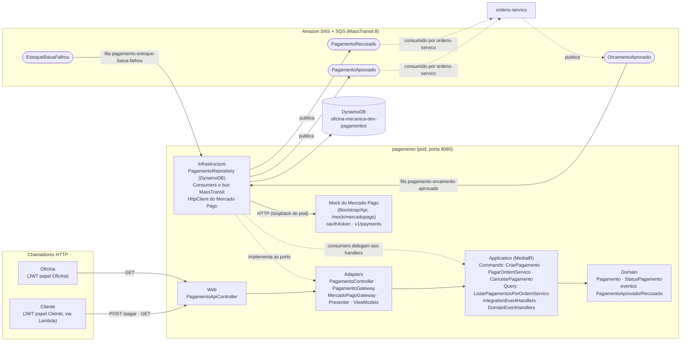
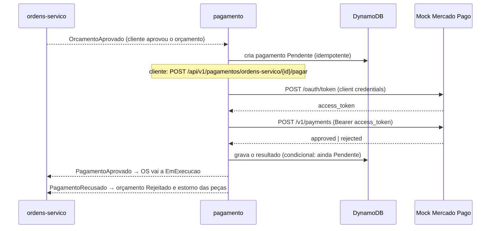

# oficina-mecanica-pagamento

Microsserviço **Pagamento** do sistema de oficina mecânica (Tech Challenge FIAP/SOAT — Fase 4). É a etapa
de pagamento da **Saga coreografada** da ordem de serviço (OS): recebe o orçamento aprovado pelo cliente,
deixa o cliente pagar por um **mock do Mercado Pago** e publica o resultado (aprovado ou recusado). O
banco é **DynamoDB** (NoSQL), uma tabela exclusiva do serviço. Mantém a Clean Architecture dos demais
serviços (`Domain` → `Application` → `Adapters` → `Infrastructure`/`Web`; host em `src/Bootstrap/Api`).

## Sumário

- [Responsabilidade](#responsabilidade)
- [Arquitetura do serviço](#arquitetura-do-serviço)
- [Tecnologias](#tecnologias)
- [API](#api)
- [Mock do Mercado Pago](#mock-do-mercado-pago)
- [Banco: tabela DynamoDB](#banco-tabela-dynamodb)
- [Eventos publicados e consumidos](#eventos-publicados-e-consumidos)
- [Limitações conhecidas](#limitações-conhecidas)
- [Configuração](#configuração)
- [Pré-requisitos e execução local](#pré-requisitos-e-execução-local)
- [Testes e evidência de cobertura](#testes-e-evidência-de-cobertura)
- [Documentação da API (OpenAPI/Scalar)](#documentação-da-api-openapiscalar)
- [Pipeline de CI/CD](#pipeline-de-cicd)
- [Deploy no EKS e limitação da AWS Academy](#deploy-no-eks-e-limitação-da-aws-academy)
- [Repositórios do sistema](#repositórios-do-sistema)

## Responsabilidade

- Criar um pagamento `Pendente` quando o cliente aprova o orçamento (evento `OrcamentoAprovado`).
- Permitir que o cliente **pague** a OS: cobrar no processador (o mock do Mercado Pago) e registrar o
  resultado.
- Publicar `PagamentoAprovado` (a OS passa a `EmExecucao`) ou `PagamentoRecusado` (compensação: a OS
  rejeita o orçamento e as peças são estornadas).
- Cancelar o pagamento `Pendente` quando a baixa de estoque do mesmo orçamento falha
  (`EstoqueBaixaFalhou`), para que não se cobre um serviço que não será executado.
- Listar os pagamentos de uma OS.

O status do pagamento (`Pendente` → `Aprovado` | `Recusado` | `Cancelado`) é interno a este serviço: a OS
não ganha status novo por causa dele. Um pagamento só sai de `Pendente` uma vez, sem volta.

## Arquitetura do serviço



O serviço não faz chamadas HTTP a outros serviços; a única chamada HTTP de saída é ao processador de
pagamento, que aqui é o mock servido pelo próprio host. A Regra de Dependência é garantida por
referências de projeto: `Domain` e `Application` não referenciam MassTransit, AWS SDK, `HttpClient` nem
ASP.NET. O processador entra pelo port `IProcessadorPagamentoGateway` (adapter `MercadoPagoGateway`) e a
persistência pelo port `IPagamentoGateway` (repositório DynamoDB na `Infrastructure`). Fluxos em detalhe e
decisões em [`docs/arquitetura.md`](docs/arquitetura.md).



## Tecnologias

| Tecnologia | Uso |
|---|---|
| .NET 10 / ASP.NET Core (Controllers + Minimal API do mock) | API REST e mock do Mercado Pago |
| MediatR + FluentValidation | commands/queries e pipeline (log, validação, transação) |
| Amazon DynamoDB (AWS SDK para .NET) | persistência dos pagamentos |
| MassTransit 8.x sobre Amazon SNS/SQS | mensageria (LocalStack no ambiente local) |
| JWT HS256 | autenticação e papéis (segredo compartilhado entre os serviços) |
| OpenTelemetry (OTLP) | traces, métricas e logs JSON com `trace_id` → New Relic (Jaeger local) |
| OpenAPI + Scalar | documentação da API |
| xUnit v3, Moq, Testcontainers (DynamoDB Local), coverlet | testes e cobertura |
| Docker, Kubernetes (EKS), GitHub Actions | empacotamento, orquestração e CI/CD |

## API

| Rota | Papel | Resposta |
|---|---|---|
| `GET /api/v1/pagamentos/ordens-servico/{ordemServicoId}` | `Cliente` (só o dono) ou `Oficina` | `200` com a lista de pagamentos da OS (`pagamentoId`, `ordemServicoId`, `orcamentoId`, `valor`, `status`, `motivoRecusa`, `criadoEm`, `atualizadoEm`); `403` se for de outro cliente |
| `POST /api/v1/pagamentos/ordens-servico/{ordemServicoId}/pagar` body `{"titularCartao": "APRO"}` | `Cliente` (só o dono) | `200` com o pagamento atualizado (aprovado **ou** recusado); `404` sem pagamento `Pendente` (inclui `Cancelado`); `403` se não for o dono ou se o papel não for `Cliente`; `422` se `titularCartao` vazio ou com mais de 100 caracteres; `409` se uma chamada simultânea já resolveu o mesmo pagamento (esta chamada não publica evento) |

"Só o dono": o `sub` do token `Cliente` precisa ser igual ao `ClienteId` do pagamento; senão `403`. Tokens
`Cliente` vêm da Lambda de autenticação por CPF; tokens `Oficina`, do serviço de autenticação. Sem token,
`401`.

Rotas técnicas, sem autenticação do JWT da oficina: `/healthz` (agrega tudo), `/healthz/live` (processo
vivo, sem dependências), `/healthz/ready` (DynamoDB — `DescribeTable` da tabela — e barramento
MassTransit), `/openapi/v1.json` e `/scalar`.

### Pagar com `APRO` ou `OTHE`

O mock segue a convenção dos cartões de teste do Mercado Pago, aplicada ao `titularCartao`:

| `titularCartao` | Resultado | Status do pagamento | Evento publicado |
|---|---|---|---|
| `APRO` | `approved` / `accredited` | `Aprovado` | `PagamentoAprovado` |
| qualquer outro valor, ex. `OTHE` | `rejected` / `cc_rejected_other_reason` | `Recusado`, com `motivoRecusa = cc_rejected_other_reason` | `PagamentoRecusado` |

## Mock do Mercado Pago

O Mercado Pago real não é integrado: o requisito é um **mock**. Ele fica em `src/Bootstrap/Api/MercadoPagoMock/`,
no host, separado do domínio, como se fosse um sistema externo. O serviço o consome **por HTTP**
(`MercadoPago__BaseUrl` aponta para o próprio serviço, `http://localhost:8080/mock/mercadopago`), como
consumiria a API real; por isso as chamadas aparecem nos traces.

**O que simula do fluxo real** — a autenticação OAuth de aplicação e a criação do pagamento:

| Etapa | Rota do mock | Contrato |
|---|---|---|
| 1. token | `POST /mock/mercadopago/oauth/token` | body `{"client_id","client_secret","grant_type":"client_credentials"}`; `200 {"access_token","token_type":"bearer","expires_in":21600}`; `400` se `grant_type` ≠ `client_credentials`; `401` se as credenciais não forem `MercadoPago__ClientId`/`MercadoPago__ClientSecret` |
| 2. pagamento | `POST /mock/mercadopago/v1/payments` | `Authorization: Bearer <access_token>` e body `{"transaction_amount","external_reference","description","card_holder_name"}`; `201 {"id","status","status_detail"}`; `400` se `transaction_amount` ≤ 0; `401` se o token for inválido ou expirado |

Detalhes do comportamento:

- `external_reference` leva o `OrcamentoId` e o adapter envia o cabeçalho `X-Idempotency-Key` (igual ao
  `OrcamentoId`), como o Mercado Pago real exige; o mock, porém, **não deduplica** cobranças.
- `card_holder_name == "APRO"` → `approved`; qualquer outro → `rejected`. O `id` do pagamento é um número
  aleatório de 11 dígitos, gravado no pagamento como `MercadoPagoPaymentId`.
- O `access_token` tem a forma `APP_USR-{expiração}-{assinatura}`, com a assinatura HMAC-SHA256 calculada
  com as credenciais configuradas, e **não fica guardado em memória**: qualquer réplica valida um token
  emitido por outra.
- As rotas do mock são anônimas para o JWT da oficina (têm autenticação própria) e ficam fora do
  middleware de autenticação JWT.

### Limitação: o mock é alcançável pela rota técnica do API Gateway

Na AWS, a rota técnica `ANY /pagamento/{proxy+}` do API Gateway (usada pelo smoke test e pelo
`/openapi/v1.json`) reescreve o caminho e também alcança `/mock/mercadopago/*`. As rotas de negócio
(`/api/v1/pagamentos/{proxy+}`) não expõem o mock. O mock exige as credenciais de cliente e o Bearer,
mas restringir o acesso por origem fica como evolução futura.

## Banco: tabela DynamoDB

Tabela **`oficina-mecanica-dev-pagamentos`** (configurável em `DynamoDb__TabelaPagamentos`), cobrança
`PAY_PER_REQUEST`. Na AWS ela é provisionada pelo Terraform
([`oficina-mecanica-infra-db`](https://github.com/gabrielMauad/oficina-mecanica-infra-db)); localmente e nos
testes o serviço a cria na partida (`DynamoDb__CriarTabelaSeNaoExistir=true`).

| Atributo | Tipo | Observação |
|---|---|---|
| `OrdemServicoId` | S | **chave de partição** |
| `OrcamentoId` | S | **chave de ordenação** |
| `PagamentoId` | S | id do pagamento |
| `ClienteId` | S | dono do pagamento (base do "só dono") |
| `Valor` | N | valor total do orçamento |
| `Status` | S | `Pendente` \| `Aprovado` \| `Recusado` \| `Cancelado` |
| `MotivoRecusa` | S | opcional: motivo da recusa (`status_detail` do mock) ou da falha de estoque que cancelou |
| `MercadoPagoPaymentId` | N | opcional: id devolvido pelo mock |
| `CriadoEm`, `AtualizadoEm` | S | ISO 8601 (UTC) |

Padrões de acesso: ler um pagamento por (OS, orçamento) e listar todos os pagamentos de uma OS (`Query` na
partição). Todas as leituras são **consistentes**, pois um pagamento recém-criado pelo consumer precisa
estar visível para quem paga em seguida.

**Escritas condicionais.** `Adicionar` usa `attribute_not_exists` na chave, impedindo que duas entregas
concorrentes do mesmo evento criem o pagamento duas vezes. `AtualizarSePendente` grava com a condição
`Status = Pendente`: só uma entre duas resoluções concorrentes (dois `/pagar`, ou um `/pagar` e um
cancelamento) vence; a outra recebe `false` e não publica evento.

**Por que NoSQL aqui.** O sistema precisa de um banco relacional e de um NoSQL, e o Pagamento é o serviço
que se encaixa no segundo:

- o agregado é um **registro autocontido**, sem junções nem consultas entre agregados;
- os acessos são **por chave** (OS + orçamento) ou pela partição da OS, exatamente o modelo de chave
  composta do DynamoDB;
- a **escrita condicional** por item entrega a concorrência otimista de que o `/pagar` precisa, sem
  transação multi-linha;
- o modo sob demanda e a ausência de migrations dispensam provisionar e versionar um servidor de banco
  para um volume pequeno e irregular de registros.

## Eventos publicados e consumidos

MassTransit 8.x sobre Amazon SNS (tópicos) e SQS (filas), com criação automática de tópicos, filas e
assinaturas. As filas levam o prefixo `pagamento`; o que conecta os serviços é o **tipo da mensagem**
(cópia idêntica do projeto de contratos em `src/Contracts/OficinaMecanica.Contracts`, namespace
`OficinaMecanica.Contracts.IntegrationEvents`). Retry de consumo: 1 s, 5 s e 10 s. O `traceparent` é
propagado pelas mensagens (`AddSource("MassTransit")`).

| Evento | Direção | Fila | Efeito |
|---|---|---|---|
| `OrcamentoAprovadoIntegrationEvent` | consome (de `ordens-servico`) | `pagamento-orcamento-aprovado` | cria o pagamento `Pendente` com o `ClienteId` e o `ValorTotal` do evento; **idempotente** |
| `EstoqueBaixaFalhouIntegrationEvent` | consome (de `pecas-insumos`) | `pagamento-estoque-baixa-falhou` | se houver pagamento `Pendente` daquela OS e orçamento → `Cancelado`, **sem publicar evento**; senão, só log |
| `PagamentoAprovadoIntegrationEvent` | publica (para `ordens-servico`) | — | a OS `AguardandoAprovacao` passa a `EmExecucao`, só se o orçamento do evento estiver `Aprovado` |
| `PagamentoRecusadoIntegrationEvent` | publica (para `ordens-servico`) | — | compensação: o orçamento `Aprovado` passa a `Rejeitado` e a OS publica `OrcamentoRejeitado` (estorno das peças) |

**Criação ao consumir `OrcamentoAprovado`.** O `CriarPagamentoHandler` consulta (OS, orçamento): se já
existe, só registra log e devolve o existente (reentrega); senão cria o `Pendente`. Se duas entregas
concorrentes disputam a criação, a gravação condicional faz a perdedora lançar exceção, e o retry do
consumer a reprocessa e cai no caso "já existe".

**Cancelamento ao consumir `EstoqueBaixaFalhou`.** A baixa de estoque do orçamento acontece em paralelo à
aprovação do cliente. Se o cliente aprovou antes de a falha chegar (pagamento `Pendente` criado), a OS
rejeita o orçamento e o pagamento não pode mais ser cobrado: o serviço busca o pagamento da OS e do
orçamento do evento; se estiver `Pendente`, passa a `Cancelado` (o motivo da falha fica em `motivoRecusa`)
sem publicar evento algum, pois a OS já conhece a falha. Se não existir pagamento (caso comum) ou ele já
não estiver `Pendente` (reentrega, pagamento já resolvido), só registra log. Um pagamento `Cancelado` não é
pagável: `POST .../pagar` responde `404` e o `GET` o lista com status `Cancelado`.

**Publicação de `PagamentoAprovado`/`PagamentoRecusado`.** `Aprovar`/`Recusar` no agregado levantam um
evento de domínio; o handler de domínio enfileira a publicação do evento de integração, que o
`TransactionBehavior` dispara **depois** que o pagamento foi gravado no DynamoDB — e só se a gravação
condicional vencer.

## Limitações conhecidas

- **Sem outbox.** O evento de integração é publicado depois de o pagamento ser gravado no DynamoDB, mas a
  gravação e a publicação não são atômicas: se a publicação falhar após gravar, o evento não é reenviado,
  o pagamento fica resolvido neste serviço e a OS continua aguardando. Um outbox é evolução futura.
- **Concorrência no `/pagar`.** A cobrança no processador acontece **antes** da gravação. A gravação é
  condicional ao pagamento ainda estar `Pendente`, então duas chamadas simultâneas nunca publicam eventos
  conflitantes: a que perde a corrida recebe `409` e não publica nada — mas a cobrança que ela já fez no
  processador (um mock, sem deduplicação) **não é desfeita**.
- **Cancelamento e pagamento simultâneos.** Se `EstoqueBaixaFalhou` e um `/pagar` chegarem ao mesmo tempo,
  vale o que gravar primeiro; se o pagamento vencer, a OS recebe `PagamentoAprovado` de um orçamento que ela
  já rejeitou e o ignora (a regra de execução da OS exige orçamento `Aprovado`).
- **Falha do processador.** Se o mock estiver indisponível, o `/pagar` falha com erro do servidor e o
  pagamento continua `Pendente`, podendo ser tentado de novo.
- **Mock exposto pela rota técnica do API Gateway** (descrita acima).

## Configuração

| Chave | Uso |
|---|---|
| `DynamoDb__TabelaPagamentos` | nome da tabela (padrão `oficina-mecanica-dev-pagamentos`; chave `OrdemServicoId` + `OrcamentoId`, ambos texto) |
| `DynamoDb__Regiao` | região (padrão `us-east-1`) |
| `DynamoDb__ServiceUrl` | **só local** (LocalStack); vazio na AWS |
| `DynamoDb__CriarTabelaSeNaoExistir` | **só local/teste**: o serviço cria a tabela na partida; na AWS é `false` e a tabela vem do Terraform |
| `MercadoPago__BaseUrl`, `MercadoPago__ClientId`, `MercadoPago__ClientSecret` | processador (mock) e suas credenciais; obrigatórios, validados na partida. Na AWS, o id e o segredo vêm do Secret do Kubernetes |
| `Mensageria__Transporte` | `AmazonSqs` (padrão) ou `InMemory` (testes) |
| `Mensageria__Regiao` | região AWS (padrão `us-east-1`) |
| `Mensageria__ServiceUrl`, `Mensageria__AccessKey`, `Mensageria__SecretKey` | **só local** (LocalStack, `test`/`test`); vazios na AWS |
| `Jwt__Secret`, `Jwt__Audience`, `Jwt__ValidIssuers__0`, `Jwt__ValidIssuers__1` | validação do JWT HS256 (`oficina-mecanica-api`; emissores `oficina-mecanica-app` e `oficina-mecanica-auth`) |
| `OpenApi__Enabled` | liga/desliga `/openapi/v1.json` e `/scalar` (padrão `true`) |
| `OTEL_SERVICE_NAME` | nome do serviço nos sinais OpenTelemetry (padrão `oficina-mecanica-pagamento`) |
| `OTEL_EXPORTER_OTLP_ENDPOINT`, `OTEL_EXPORTER_OTLP_PROTOCOL`, `OTEL_EXPORTER_OTLP_HEADERS` | destino OTLP (Jaeger local; New Relic na AWS, com a license key no header) |
| `ASPNETCORE_URLS` | `http://+:8080` dentro do container |

As credenciais do DynamoDB e do SNS/SQS vêm da cadeia padrão do SDK da AWS: na AWS, a role do nó; local,
as variáveis `AWS_ACCESS_KEY_ID`/`AWS_SECRET_ACCESS_KEY` do `docker-compose.yml`. Valores locais do mock:
`MercadoPago__ClientId=mp-dev-client` e `MercadoPago__ClientSecret=mp-dev-secret`. Na AWS, o ConfigMap
`pagamento-config` (`k8s/01-configmap.yaml`) traz as chaves não sensíveis e o Secret `pagamento-secrets` —
criado pela pipeline, nunca versionado — traz `Jwt__Secret`, `MercadoPago__ClientId`,
`MercadoPago__ClientSecret` e o header OTLP.

## Pré-requisitos e execução local

Pré-requisitos: Docker (com Compose v2) e .NET 10 SDK (este último só para rodar os testes fora de
container).

1. No repositório [`oficina-mecanica-app`](https://github.com/gabrielMauad/oficina-mecanica-app), suba as
   dependências compartilhadas: a rede Docker `oficina-local`, o LocalStack (SQS/SNS/DynamoDB) e o Jaeger.

   ```bash
   docker compose -f docker-compose.infra.yml up -d
   ```

2. Neste repositório, suba o serviço:

   ```bash
   docker compose up --build
   ```

| Item | Endereço |
|---|---|
| API e Scalar | <http://localhost:8084> (`/scalar`) |
| Mock do Mercado Pago | <http://localhost:8084/mock/mercadopago> |
| Traces (Jaeger) | <http://localhost:16686> |

Para exercitar o fluxo é preciso um JWT com papel `Cliente` (emitido pela Lambda de autenticação por CPF)
ou `Oficina` (pelo serviço de autenticação), com o mesmo `Jwt__Secret`, e o evento `OrcamentoAprovado`
vindo do `ordens-servico` para criar o pagamento `Pendente`.

## Testes e evidência de cobertura

```bash
dotnet build OficinaMecanica.Pagamento.slnx
dotnet test OficinaMecanica.Pagamento.slnx
# só os unitários (sem Docker):
dotnet test tests/Modules/Pagamento/Pagamento.Domain.Tests
dotnet test tests/Modules/Pagamento/Pagamento.Application.Tests
dotnet test tests/Modules/Pagamento/Pagamento.Adapters.Tests
dotnet test tests/Modules/Pagamento/Pagamento.Infrastructure.Tests
```

| Projeto de teste | O que cobre |
|---|---|
| `Pagamento.Domain.Tests` | transições de status do agregado `Pagamento` |
| `Pagamento.Application.Tests` | commands, query e event handlers (criar, pagar, cancelar, publicar) |
| `Pagamento.Adapters.Tests` | gateways (inclusive o `MercadoPagoGateway` com `HttpClient` simulado) e mapeamentos |
| `Pagamento.Infrastructure.Tests` | consumers, mensageria, mapeamento e inicialização da tabela DynamoDB |
| `tests/IntegrationTests` | API e Saga ponta a ponta com **Testcontainers (DynamoDB Local)**, exige Docker; MassTransit no transporte `InMemory` com test harness: criação por evento, `APRO`/`OTHE`, `409` em `/pagar` simultâneo, cancelamento, `401/403/404/422`, mock do Mercado Pago, saúde |

**Evidência de cobertura.** O CI consolida os relatórios `coverage.opencover.xml` de todos os projetos
de teste (unitários e de integração) com o ReportGenerator e **falha se a cobertura de linhas do serviço
ficar abaixo de 80%** (passo "Gate de cobertura (linhas >= 80%)"). A métrica cobre todos os assemblies de
`src/`, inclusive o mock do Mercado Pago no host. Exclusões, em `coverlet.runsettings`: `**/Program.cs`
(composição do host) e `**/*.generated.cs` (código gerado em tempo de build); o serviço não tem
migrations.

- **Gate do CI: 93,8% de cobertura de linhas** (mínimo exigido: 80%), no run da `main` do commit
  `65f6633`: [run 43552027438](https://github.com/gabrielMauad/oficina-mecanica-pagamento/actions/runs/43552027438).
  O job `Build & Test` desse run está verde. Os jobs seguintes (imagem e deploy) falharam porque as
  credenciais de sessão da AWS Academy não estavam carregadas — ver
  [Deploy no EKS](#deploy-no-eks-e-limitação-da-aws-academy).
- <!-- sonarcloud-link -->SonarCloud: link público do projeto a ser preenchido quando a análise for configurada.

## Documentação da API (OpenAPI/Scalar)

O documento OpenAPI (com o esquema `Bearer` e a segurança por operação) é gerado pelo próprio serviço:

| Onde | URL |
|---|---|
| Local | <http://localhost:8084/openapi/v1.json> · UI Scalar em <http://localhost:8084/scalar> (a raiz `/` redireciona para ela) |
| Via API Gateway (AWS) | `<url-do-api-gateway>/pagamento/openapi/v1.json` |

A URL do API Gateway é descoberta pelo nome da API (`oficina-mecanica-api`), nunca fixa. A coleção de
requisições do sistema inteiro fica em `docs/guias` do repositório
[`oficina-mecanica-app`](https://github.com/gabrielMauad/oficina-mecanica-app).

## Pipeline de CI/CD

| Workflow | Quando | O que faz |
|---|---|---|
| `.github/workflows/ci.yml` | pull request para `main` | job **`Build & Test`**: restore, build (Release), testes com cobertura, gate de 80% de linhas e, se configurado, análise SonarCloud |
| `.github/workflows/ci-cd.yml` | push na `main` e `workflow_dispatch` | `Build & Test` (idêntico ao do `ci.yml`) → `Build & Push image (ECR)` → `Deploy no EKS` |

Detalhes do `ci-cd.yml`:

1. **Build & Test** — restore, build, testes com `coverlet.runsettings`, gate de cobertura. A análise
   SonarCloud só roda quando o secret `SONAR_TOKEN` e as variables `SONAR_PROJECT_KEY` e
   `SONAR_ORGANIZATION` existem; sem eles, build, testes e gate seguem normalmente.
2. **Build & Push image (ECR)** — constrói `src/Bootstrap/Api/Dockerfile` (multi-stage, .NET 10) e envia
   para o repositório ECR `oficina-mecanica-pagamento` com a tag igual ao SHA do commit; a URL do
   repositório é resolvida em tempo de execução (`describe-repositories`).
3. **Deploy no EKS** — configura o kubeconfig do cluster `oficina-mecanica`, aplica o namespace, cria/atualiza
   o Secret `pagamento-secrets` a partir do Secrets Manager (segredo `oficina-mecanica/dev/app`; cada valor
   sensível recebe `::add-mask::`), aplica ConfigMap, Deployment (com a imagem do SHA), Service e HPA,
   aguarda o `rollout status` e executa o **smoke test** `GET <api-gateway>/pagamento/healthz/ready`, com
   retentativas.

O branch `main` é protegido; o status check obrigatório é o `Build & Test`.

## Deploy no EKS e limitação da AWS Academy

Manifestos em [`k8s/`](k8s/), namespace `oficina-mecanica` (compartilhado pelos serviços):

| Recurso | Detalhes |
|---|---|
| `Deployment`/`Service` `pagamento` | `Service` NodePort `80 → 8080`, **nodePort 30084** (porta do listener deste serviço na NLB interna) |
| `HorizontalPodAutoscaler` `pagamento-hpa` | mínimo 1, máximo 3 réplicas, CPU alvo 50% |
| Recursos | requests `100m`/`256Mi`, limits `500m`/`512Mi` |
| Probes | startup e liveness em `/healthz/live`; readiness em `/healthz/ready` (DynamoDB e barramento) |

O tráfego chega pelo API Gateway (`ANY /api/v1/pagamentos/{proxy+}`) → VPC Link → NLB → NodePort → pod. A
rota técnica `ANY /pagamento/{proxy+}` reescreve o caminho e serve o smoke test e o `/openapi/v1.json`. A
infraestrutura (cluster, NLB, API Gateway, ECR, tabela DynamoDB) pertence aos repositórios de Terraform;
esta pipeline só publica o serviço nela.

**Limitação da AWS Academy.** A conta é um Learner Lab: não permite criar roles IAM nem OIDC.

- A pipeline autentica com as **três credenciais temporárias da sessão do laboratório** (secrets
  `AWS_ACCESS_KEY_ID`, `AWS_SECRET_ACCESS_KEY` e `AWS_SESSION_TOKEN`, no environment `aws-academy`),
  que **precisam ser renovadas manualmente a cada sessão** (decisão registrada no ADR-006 do repositório
  `oficina-mecanica-app`). Sem elas, os jobs de imagem e de deploy falham ao carregar as credenciais; o
  deploy é reexecutável por `workflow_dispatch` depois de renovar os secrets.
- Os pods **não usam IRSA**: acessam DynamoDB, SNS e SQS com as credenciais da **role do nó**, obtidas pelo
  serviço de metadados da instância (IMDS) pela cadeia padrão do SDK. Por isso `DynamoDb__ServiceUrl`,
  `Mensageria__ServiceUrl`, `Mensageria__AccessKey` e `Mensageria__SecretKey` ficam vazios na AWS.

## Repositórios do sistema

| Repositório | Papel |
|---|---|
| [`oficina-mecanica-app`](https://github.com/gabrielMauad/oficina-mecanica-app) | OrdensServico (ciclo da OS e do orçamento; publica `OrcamentoAprovado` e consome `PagamentoAprovado`/`PagamentoRecusado`) e visão geral do sistema |
| [`oficina-mecanica-cadastro`](https://github.com/gabrielMauad/oficina-mecanica-cadastro) | Cadastro de clientes, veículos e serviços |
| [`oficina-mecanica-pecas-insumos`](https://github.com/gabrielMauad/oficina-mecanica-pecas-insumos) | Peças e estoque (publica `EstoqueBaixaFalhou`) |
| [`oficina-mecanica-pagamento`](https://github.com/gabrielMauad/oficina-mecanica-pagamento) | **este repositório** |
| [`oficina-mecanica-autenticacao`](https://github.com/gabrielMauad/oficina-mecanica-autenticacao) | Login da oficina e emissão do JWT |
| [`oficina-mecanica-lambda-auth`](https://github.com/gabrielMauad/oficina-mecanica-lambda-auth) | Lambda de autenticação por CPF (token do cliente) |
| [`oficina-mecanica-infra-k8s`](https://github.com/gabrielMauad/oficina-mecanica-infra-k8s) | Terraform: EKS, NLB, API Gateway, ECR, segredo da aplicação |
| [`oficina-mecanica-infra-db`](https://github.com/gabrielMauad/oficina-mecanica-infra-db) | Terraform: instâncias RDS e tabela DynamoDB |
