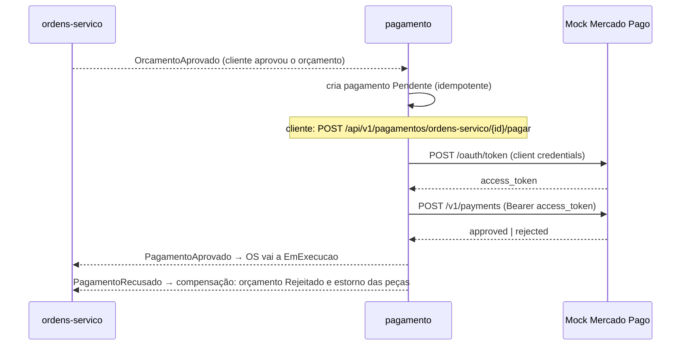

# oficina-mecanica-pagamento

Microsserviço **Pagamento** do sistema de oficina mecânica (Tech Challenge FIAP/SOAT — Fase 4). É a
etapa de pagamento da Saga coreografada da ordem de serviço (OS): recebe o orçamento aprovado, deixa o
cliente pagar por um **mock do Mercado Pago** e publica o resultado. Banco próprio **DynamoDB** (NoSQL).
Mantém a Clean Architecture dos demais serviços (`Domain` → `Application` → `Adapters` →
`Infrastructure`/`Web`, host em `src/Bootstrap/Api`).

## Fluxo



O status do pagamento (`Pendente` → `Aprovado` | `Recusado`) é interno a este serviço; a OS não ganha
status novo. Os eventos são publicados em SNS/SQS por MassTransit (8.x) **depois** que o pagamento foi
gravado no DynamoDB. Este serviço consome `OrcamentoAprovado` (fila `pagamento-orcamento-aprovado`) e
publica `PagamentoAprovado` e `PagamentoRecusado`; os tipos dos eventos estão em
`src/Contracts/OficinaMecanica.Contracts`, cópia idêntica à dos demais serviços.

## API

| Rota | Papel | Resposta |
|---|---|---|
| `GET /api/v1/pagamentos/ordens-servico/{ordemServicoId}` | `Cliente` (só o dono) ou `Oficina` | 200 com a lista de pagamentos da OS; 403 se for de outro cliente |
| `POST /api/v1/pagamentos/ordens-servico/{ordemServicoId}/pagar` body `{"titularCartao": "APRO"}` | `Cliente` (só o dono) | 200 com o pagamento atualizado (aprovado **ou** recusado); 404 sem pagamento `Pendente`; 403 se não for o dono; 422 se o titular for inválido |

Além delas: `/healthz`, `/healthz/live`, `/healthz/ready` (verifica o DynamoDB e o barramento),
`/openapi/v1.json` e `/scalar`. Autenticação por JWT HS256 com segredo compartilhado (tokens do serviço
de autenticação, papel `Oficina`, e da Lambda de autenticação por CPF, papel `Cliente`).

### Pagar com `APRO` ou `OTHE`

O mock segue a convenção dos cartões de teste do Mercado Pago, aplicada ao `titularCartao`:

| `titularCartao` | Resultado do pagamento | Evento publicado |
|---|---|---|
| `APRO` | `Aprovado` (`approved` / `accredited`) | `PagamentoAprovado` |
| qualquer outro valor, ex. `OTHE` | `Recusado`, `motivoRecusa = cc_rejected_other_reason` | `PagamentoRecusado` |

## Mock do Mercado Pago

Fica em `src/Bootstrap/Api/MercadoPagoMock/`, separado do domínio, simulando um sistema externo. O
serviço o consome **por HTTP** (`MercadoPago__BaseUrl`, que aponta para o próprio serviço), como
consumiria o Mercado Pago real, então as chamadas aparecem nos traces.

- `POST /mock/mercadopago/oauth/token` — body `{"client_id","client_secret","grant_type":"client_credentials"}`;
  200 `{"access_token","token_type":"bearer","expires_in":21600}`; 401 se as credenciais não forem
  `MercadoPago__ClientId`/`MercadoPago__ClientSecret`.
- `POST /mock/mercadopago/v1/payments` — `Authorization: Bearer <access_token>` e body
  `{"transaction_amount","external_reference","description","card_holder_name"}`; 201
  `{"id","status","status_detail"}`; 401 se o token for inválido.

O `access_token` é assinado (HMAC) com as credenciais configuradas e não fica guardado em memória:
qualquer réplica do serviço valida um token emitido por outra.

### Limitação conhecida

Na AWS, a rota técnica `ANY /pagamento/{proxy+}` do API Gateway também alcança
`/mock/mercadopago/*`. O mock exige as credenciais de cliente e o Bearer, mas restringir o acesso por
origem fica como evolução futura.

## Configuração

| Chave | Uso |
|---|---|
| `DynamoDb__TabelaPagamentos` | nome da tabela (chave: `OrdemServicoId` + `OrcamentoId`, ambos texto) |
| `DynamoDb__ServiceUrl` | só local (LocalStack); vazio na AWS |
| `DynamoDb__CriarTabelaSeNaoExistir` | só local/teste: o serviço cria a tabela na partida. Na AWS a tabela vem do Terraform |
| `DynamoDb__Regiao` | opcional, padrão `us-east-1` |
| `MercadoPago__BaseUrl`, `MercadoPago__ClientId`, `MercadoPago__ClientSecret` | processador (mock) e suas credenciais |
| `Mensageria__Transporte`, `Mensageria__Regiao`, `Mensageria__ServiceUrl`, `Mensageria__AccessKey`, `Mensageria__SecretKey` | `AmazonSqs` (padrão) ou `InMemory`; `ServiceUrl` e chaves só local |
| `Jwt__Secret`, `Jwt__Audience`, `Jwt__ValidIssuers__0/1` | validação do JWT |
| `OTEL_SERVICE_NAME`, `OTEL_EXPORTER_OTLP_*` | observabilidade (padrão `oficina-mecanica-pagamento`) |

As credenciais do DynamoDB vêm da cadeia padrão do SDK da AWS (na AWS, a role do nó; local, as
variáveis `AWS_ACCESS_KEY_ID`/`AWS_SECRET_ACCESS_KEY` do `docker-compose.yml`).

## Executar localmente

Este serviço usa a rede Docker externa `oficina-local`, o LocalStack (SQS/SNS/DynamoDB) e o Jaeger,
criados pelo `docker-compose.infra.yml` do repositório `oficina-mecanica-app`.

```bash
# 1. no repositório oficina-mecanica-app: cria a rede oficina-local e sobe LocalStack + Jaeger
docker compose -f docker-compose.infra.yml up -d

# 2. neste repositório: sobe o serviço de Pagamento
docker compose up --build
```

| Item | Valor |
|---|---|
| API | http://localhost:8084 (Scalar em `/scalar`) |
| Mock do Mercado Pago | http://localhost:8084/mock/mercadopago |
| Jaeger | http://localhost:16686 |

Credenciais locais do mock: `MercadoPago__ClientId=mp-dev-client` e `MercadoPago__ClientSecret=mp-dev-secret`.

## Testes

```bash
dotnet build OficinaMecanica.Pagamento.slnx
dotnet test OficinaMecanica.Pagamento.slnx
```

Os testes de integração (`tests/IntegrationTests`) usam Testcontainers (DynamoDB Local) e exigem Docker
em execução. Para rodar só os testes unitários:

```bash
dotnet test tests/Modules/Pagamento/Pagamento.Domain.Tests
dotnet test tests/Modules/Pagamento/Pagamento.Application.Tests
dotnet test tests/Modules/Pagamento/Pagamento.Adapters.Tests
dotnet test tests/Modules/Pagamento/Pagamento.Infrastructure.Tests
```

## Pipeline

`.github/workflows/ci.yml` — em pull request para `main`: restore, build (Release) e testes com .NET 10
(job `Build & Test`, status check obrigatório).
