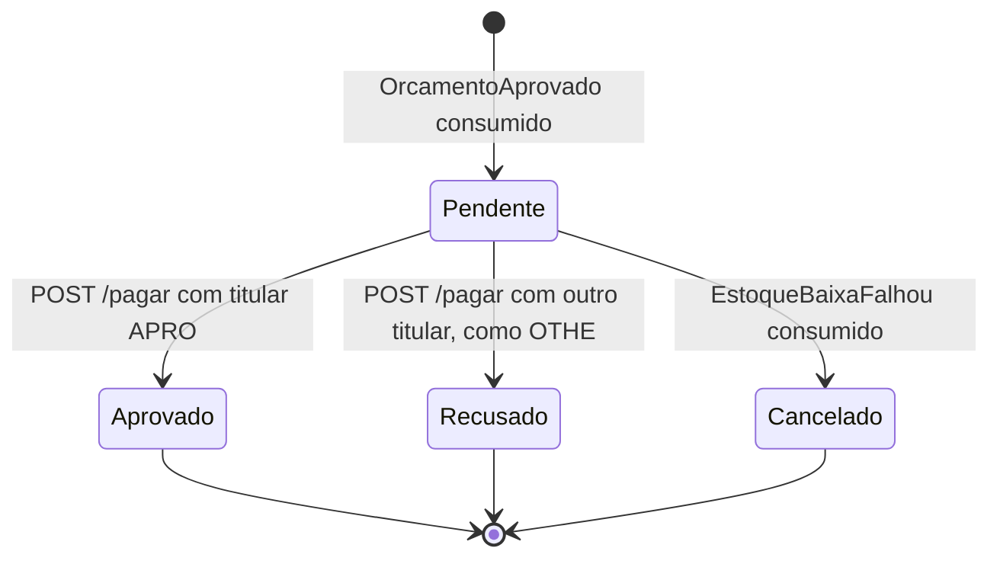
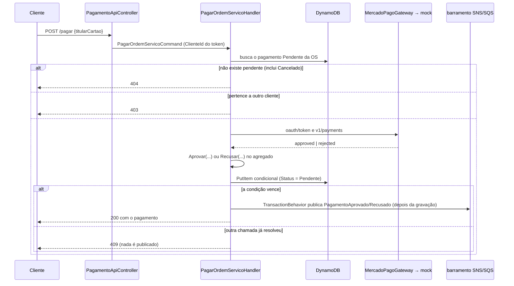

# Arquitetura do serviço Pagamento

Complementa o [README](../README.md) com a estrutura de projetos, o ciclo de vida do pagamento, os fluxos
em detalhe e as decisões de projeto do serviço.

## Estrutura de projetos

```
src/Bootstrap/Api/                       host: Program.cs, autenticação, OpenAPI, health checks, observabilidade
  MercadoPagoMock/                       mock do Mercado Pago (endpoints, modelos, serviço de token)
src/Modules/Pagamento/
  Pagamento.Domain/                      Pagamento (agregado), StatusPagamento, eventos de domínio
  Pagamento.Application/                 Commands, Query, Integration/DomainEventHandlers, ports IPagamentoGateway e IProcessadorPagamentoGateway
  Pagamento.Adapters/                    PagamentoController (CA), PagamentoGateway, MercadoPagoGateway, Presenter, Requests/ViewModels
  Pagamento.Infrastructure/              PagamentoRepository (DynamoDB), consumers e bus MassTransit, HttpClient do Mercado Pago
  Pagamento.Web/                         PagamentoApiController (rotas HTTP e papéis)
src/SharedKernel/                        Result/Error, behaviors do MediatR, IIntegrationEventBus
src/Contracts/OficinaMecanica.Contracts  eventos de integração (cópia idêntica em todos os serviços)
```

Direção das dependências: `Web → Adapters → Application → Domain`; `Infrastructure` implementa os ports.
`Domain` e `Application` não referenciam MassTransit, AWS SDK, `HttpClient` nem ASP.NET. O mock do Mercado
Pago fica no host (`Bootstrap/Api`), fora dos módulos, porque simula um sistema externo e não pertence ao
domínio.

## Ciclo de vida do pagamento



O agregado só aceita `Aprovar`, `Recusar` e `Cancelar` a partir de `Pendente`; qualquer outra transição
devolve um conflito de domínio. `Aprovar` e `Recusar` levantam evento de domínio; `Cancelar` não levanta
evento algum, porque decorre de um evento que a OS já conhece.

## Fluxo 1 — criação do pagamento (`OrcamentoAprovado`)

1. A OS publica `OrcamentoAprovado` com `OrdemServicoId`, `OrcamentoId`, `ClienteId` e `ValorTotal`.
2. O `OrcamentoAprovadoConsumer` (fila `pagamento-orcamento-aprovado`) delega ao
   `CriarPagamentoQuandoOrcamentoAprovado`, que envia `CriarPagamentoCommand`.
3. O handler consulta (OS, orçamento): se já existe, registra log e devolve o existente (reentrega); senão
   cria o agregado `Pendente` e o grava com `attribute_not_exists` na chave, de modo que duas entregas
   concorrentes não criam dois pagamentos — a perdedora lança exceção e o retry cai no caso "já existe".

## Fluxo 2 — pagar (`POST .../pagar`)



- A cobrança no processador acontece **antes** da gravação; a gravação condicional decide qual chamada
  concorrente "vale". A que perde recebe `409`, sem evento, mas já foi cobrada no mock (limitação
  documentada no README).
- `MercadoPagoGateway` reproduz o fluxo do Mercado Pago real: obtém o token por credenciais de cliente e
  cria o pagamento com ele como Bearer. Qualquer status diferente de `approved` é tratado como recusa, com
  o `status_detail` como motivo.
- Falha do processador (mock indisponível ou resposta de erro) lança exceção: o pagamento segue `Pendente`
  e nenhum evento é publicado.

## Fluxo 3 — cancelamento (`EstoqueBaixaFalhou`)

1. O `pecas-insumos` publica `EstoqueBaixaFalhou` quando a baixa do orçamento não é possível.
2. O `EstoqueBaixaFalhouConsumer` (fila `pagamento-estoque-baixa-falhou`) delega ao
   `CancelarPagamentoQuandoEstoqueBaixaFalhou` → `CancelarPagamentoCommand`.
3. Sem pagamento (caso comum: o cliente ainda não aprovou) ou pagamento que já não está `Pendente`
   (reentrega, já resolvido): só log. Com `Pendente`: `Cancelar(motivo)` e gravação condicional
   (`Status = Pendente`); se uma chamada concorrente resolveu antes, o cancelamento é ignorado com log.
4. Nenhum evento é publicado: a OS já rejeitou o orçamento ao receber a mesma falha.

## Decisões de projeto

| Decisão | Razão |
|---|---|
| Mock do Mercado Pago **no próprio host**, consumido **por HTTP** | o adapter exercita o mesmo caminho que usaria com a API real (token → pagamento), aparece nos traces e pode ser trocado só por `MercadoPago__BaseUrl` e credenciais |
| Token do mock **sem estado** (HMAC das credenciais) | qualquer réplica valida o token emitido por outra, sem armazenamento compartilhado |
| **DynamoDB** com chave (`OrdemServicoId`, `OrcamentoId`) | agregado autocontido, acesso por chave, escrita condicional como concorrência otimista; cobre o requisito de um serviço com NoSQL |
| Gravação **condicional** em vez de bloqueio | resolve a corrida entre `/pagar` simultâneos e entre `/pagar` e cancelamento sem coordenação entre réplicas |
| Eventos de integração saem de **eventos de domínio**, depois da gravação | só um pagamento efetivamente gravado gera evento; a chamada perdedora não publica nada |
| `Cancelado` **sem evento** | a OS já recebeu `EstoqueBaixaFalhou`; um novo evento só criaria ruído |
| Consumers MassTransit finos | mantêm a Application independente do transporte |
| Leituras **consistentes** | o pagamento criado pelo consumer precisa estar visível para o `/pagar` seguinte |

## Limitações e evolução futura

Descritas no [README](../README.md#limitações-conhecidas): sem outbox, cobrança já feita pela chamada
perdedora do `/pagar`, cancelamento e pagamento simultâneos, e mock alcançável pela rota técnica do API
Gateway.
